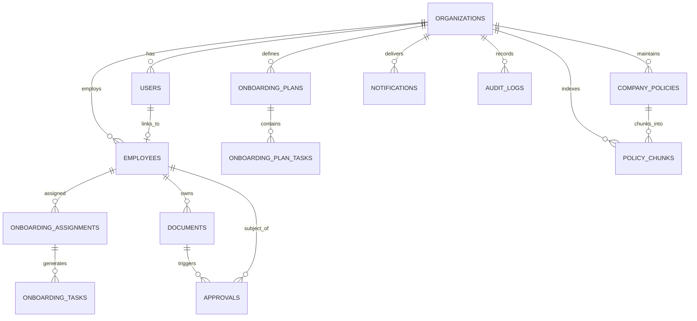

# OnboardAI — Architecture & Technical Design

## 1. Executive Overview

**OnboardAI** is an enterprise-grade AI-powered Employee Onboarding Platform designed to streamline the journey from offer acceptance to productive team membership. It provides HR administrators, HR managers, people managers, and new hires with dedicated, role-specific interfaces, automated task orchestration, document verification workflows, policy retrieval (RAG), and intelligent onboarding copilots.

---

## 2. Monorepo Layout

```
OnboardAI/
├── backend/                  # Java 21 + Spring Boot 3.x REST API
│   ├── src/
│   │   ├── main/
│   │   │   ├── java/com/onboardai/
│   │   │   │   ├── common/         # Global exceptions, base entity, API response, audit
│   │   │   │   ├── config/         # Security, CORS, OpenAPI, Storage, Async
│   │   │   │   ├── security/       # JWT filters, UserPrincipal, TenantFilter
│   │   │   │   ├── auth/           # Login, Token refresh, AuthController
│   │   │   │   ├── users/          # User entity, repo, service, DTOs
│   │   │   │   ├── employees/      # Employee profile, CRUD, status management
│   │   │   │   ├── onboarding/     # OnboardingPlan, PlanTemplate, Assignment
│   │   │   │   ├── tasks/          # OnboardingTask, status lifecycle, comments
│   │   │   │   ├── documents/      # Document entity, storage provider, verification
│   │   │   │   ├── approvals/      # Approval workflows (approver actions, history)
│   │   │   │   ├── policies/       # CompanyPolicy, RAG chunking & storage
│   │   │   │   ├── ai/             # AI service abstraction, LLM provider, fallback
│   │   │   │   ├── notifications/  # Notification entity, repository, polling API
│   │   │   │   ├── analytics/      # Aggregated metrics for HR/Managers/Employees
│   │   │   │   └── audit/          # AuditLog persistence & queries
│   │   │   └── resources/
│   │   │       ├── db/migration/   # Flyway V1..Vn SQL scripts
│   │   │       ├── application.yml
│   │   │       └── application-dev.yml
│   │   └── test/                   # JUnit 5 & Mockito test suites
│   └── pom.xml
├── frontend/                 # React 18+ / Vite / TypeScript / Tailwind CSS
│   ├── src/
│   │   ├── components/       # UI library (Buttons, Dialogs, Cards, Tables, Skeletons)
│   │   ├── layouts/          # DashboardLayout, AuthLayout, Sidebar, Topbar
│   │   ├── pages/            # Role-aware routes (Overview, Employees, Tasks, Docs, etc.)
│   │   ├── features/         # Feature modules (AI Chat, Document Extractor, Approvals)
│   │   ├── hooks/            # useAuth, useTenant, useNotifications
│   │   ├── services/         # Axios API client, query hooks
│   │   ├── types/            # TypeScript models & API contract types
│   │   ├── schemas/          # Zod validation schemas
│   │   └── utils/            # Formatters, date helpers, status badges
│   ├── package.json
│   ├── vite.config.ts
│   └── tailwind.config.js
├── docs/                     # Architecture, API specs, implementation plan
├── docker-compose.yml        # PostgreSQL container configuration
├── .env.example              # Template for environment variables
├── .gitignore
└── README.md
```

---

## 3. Technology Stack & Key Libraries

### Backend
- **Language/Framework**: Java 21 LTS, Spring Boot 3.3.x
- **Build System**: Maven 3.9+
- **Data & Persistence**: Spring Data JPA, Hibernate, PostgreSQL, Flyway Database Migrations
- **Security**: Spring Security 6 with stateless JWT Bearer token authentication, BCrypt password hashing, and tenant context propagation via `ThreadLocal` / security context.
- **Validation**: Jakarta Bean Validation (`hibernate-validator`)
- **API Documentation**: Springdoc OpenAPI 3 (Swagger UI at `/swagger-ui.html`)
- **Observability**: Spring Boot Actuator (`/actuator/health`)
- **Testing**: JUnit 5, Mockito, Spring Boot Test, H2/PostgreSQL test profiles

### Frontend
- **Framework**: React 18+, Vite, TypeScript
- **Styling**: Tailwind CSS with custom design tokens (light lavender background, deep navy text, soft violet accents, clean glassmorphic touches)
- **State & Data Fetching**: TanStack Query (React Query v5) for cache & server synchronization
- **Routing**: React Router v6 with authenticated and role-guarded Route wrappers
- **Form Management**: React Hook Form with Zod schema validation
- **Icons & Visuals**: Lucide React icons, Recharts for dynamic analytics charts
- **HTTP Client**: Axios with automatic JWT injection and 401 handling

### AI & RAG Subsystem
- **Abstraction**: `AiProviderService` interface decoupled from vendor implementations.
- **Implementations**:
  - `DefaultHttpAiProvider`: Connects to modern OpenAI-compatible endpoints (or Gemini / Anthropic via configured HTTP adapter) via standard HTTP requests and environment variables (`AI_API_KEY`, `AI_MODEL_NAME`, `AI_API_URL`).
  - `FallbackAiProvider`: Transparent, high-fidelity synthetic fallback provider active when no API key is supplied. Visibly marked with `isFallback: true` and synthetic badge.
- **RAG Architecture**:
  - Policy ingestion -> Text extraction -> Semantic chunking (300-500 words with overlap) -> Keyword/Lexical + Vector similarity search -> Authorized prompt assembly -> Grounded response with citations (title, section, snippet).

---

## 4. Multi-Tenant Security & Role-Based Access Control (RBAC)

### Organization Isolation
All persistent domain entities contain `organization_id`. The API enforces tenant isolation on two layers:
1. **Security Context / Tenant Context Filter**: Extracts tenant affiliation from the authenticated JWT token.
2. **Repository & Service Enforcement**: All query filters and mutation checks explicitly filter by `organization_id = :orgId`. Unauthenticated or cross-organization accesses yield `403 Forbidden` or `404 Not Found`.

### Role Definitions
1. **`HR_ADMIN`**: Full platform authority within the organization (manage plans, employees, policies, templates, documents, approvals, audit logs, analytics).
2. **`HR_MANAGER`**: Manages employee onboardings, tasks, plan assignments, document verifications, and approvals.
3. **`MANAGER`**: Supervises direct reports; views team onboarding progress, approves manager tasks, and provides feedback.
4. **`EMPLOYEE`**: Accesses personal onboarding dashboard, completes assigned tasks, uploads required documents, views personal progress, and queries the Policy AI Copilot.

---

## 5. Core Data Model & ERD



---

## 6. API Guidelines & Error Handling

All endpoints follow RESTful conventions under `/api/v1/`:
- Consistent Error Envelope:
  ```json
  {
    "timestamp": "2026-10-28T14:30:00Z",
    "status": 400,
    "error": "BAD_REQUEST",
    "message": "Validation failed for request fields",
    "details": ["email: Must be a valid email address"],
    "path": "/api/v1/employees"
  }
  ```
- No stack traces or secrets leak in error responses.
- Auditing: Sensitive changes (employee creation, task completion, document rejection/approval, policy publication) generate immutable `AuditLog` records.
